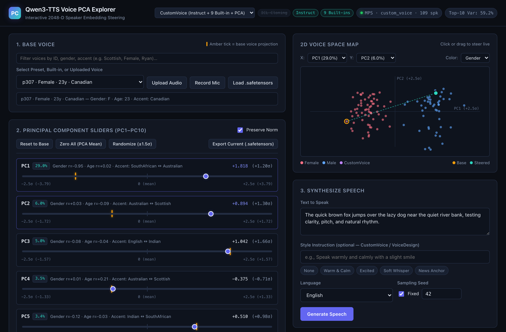

# Qwen3-TTS Voice PCA Explorer

An interactive local Python + web studio for **macOS (Apple Silicon / MPS)** that discovers the top principal components of Qwen3-TTS's 2048-D speaker embedding space, correlates each axis with speaker metadata (gender, age, accent), and lets you steer any voice along **PC1–PC10** in real time.



## Motivation

Qwen3-TTS represents speaker identity as a 2048-dimensional x-vector extracted by an ECAPA-TDNN speaker encoder. Normally, that vector is a black box: you either pick a preset speaker or clone a reference clip verbatim.

By running PCA across 109 multi-speaker VCTK voices (`545` utterances), we uncover an orthogonal, interpretable coordinate system inside the 2048-D speaker space — where **PC1 alone captures 29.0% of variance and correlates with gender at `r = -0.95`**, and subsequent axes capture accent, age, and timbral qualities. This tool lets you:

- **Explore & steer visually** on an interactive **2D Voice Space Map** (click/drag across any pair of PCs, colored by gender or accent) and 10 calibrated `±2.5σ` sliders with norm preservation.
- **Start from any voice** — the PCA mean, 109 VCTK speakers (searchable & grouped), CustomVoice's 9 built-in speakers, an uploaded `.wav`/`.mp3` chunk, a live mic recording, or a previously saved `.safetensors` embedding.
- **Compare models live in the UI** — switch between `Base` (high-fidelity ICL cloning + PCA steering), `CustomVoice` (style `instruct` + 9 built-in voices + PCA steering), and `VoiceDesign`.
- **Export & re-import steered embeddings** as `.safetensors` (`speaker_embedding`, shape `(2048,)`, `float32`) to reuse in downstream TTS pipelines.

---

## Quick Start (macOS Apple Silicon)

### Prerequisites
- macOS on Apple Silicon (M1/M2/M3/M4 — uses MPS `bfloat16` + `sdpa`, with automatic CPU fallback)
- Python 3.11 or 3.12 (`arm64`) and [`uv`](https://docs.astral.sh/uv/)
- Optional: `brew install sox ffmpeg` (recommended for `qwen-tts` and decoding `.mp3`/`.m4a` uploads)

### 1. Clone & install dependencies

```bash
git clone https://github.com/rahimnathwani/qwen3-tts-voice-pca-explorer.git
cd qwen3-tts-voice-pca-explorer
uv sync --python 3.12
```

> **Apple Silicon tip**: If `uv` picks an x86_64/Rosetta Python, explicitly pass an `arm64` interpreter (e.g. `uv sync --python /opt/homebrew/bin/python3.12`) so PyTorch MPS is enabled.

### 2. Launch the web UI

Pre-computed VCTK PCA artifacts (`data/pca_model.npz` and `data/pca_meta.json`, ~1 MB total) are included in the repo, so you can start the app immediately:

```bash
uv run uvicorn app:app --host 127.0.0.1 --port 8000
```

Open **[http://127.0.0.1:8000](http://127.0.0.1:8000)** in your browser.

> First startup downloads the Qwen3-TTS 1.7B checkpoint (~3.8 GB) into your Hugging Face cache (`~/.cache/huggingface`). You may see `Warning: flash-attn is not installed...` from `qwen_tts` — this is harmless on macOS because the app uses PyTorch's native Metal `sdpa` backend.

### 3. (Optional) Rebuild the PCA model from scratch

To re-run the offline pipeline yourself (streams `mteb/cstr-vctk-accent-mini` directly from Hugging Face Parquet without downloading the 40 GB VCTK archive):

```bash
uv run python build_pca.py
```

---

## Discovered PCA Axes (VCTK, 109 Speakers / 545 Clips)

Top-10 cumulative explained variance: **59.24%**

| PC | Var % | Std (`σ`) | Slider Range (`±2.5σ`) | Gender `r` (`F=1, M=0`) | Age `r` | Accent Spread (Low ↔ High) |
| :--- | ---: | ---: | :---: | ---: | ---: | :--- |
| **PC1** | 28.96% | 1.515 | `[-3.79, +3.79]` | **-0.952** | +0.018 | SouthAfrican ↔ Australian |
| **PC2** | 5.96% | 0.687 | `[-1.72, +1.72]` | +0.026 | -0.090 | Australian ↔ Scottish |
| **PC3** | 4.99% | 0.629 | `[-1.57, +1.57]` | -0.082 | -0.038 | English ↔ Indian |
| **PC4** | 3.54% | 0.530 | `[-1.33, +1.33]` | +0.007 | **+0.205** | Australian ↔ Scottish |
| **PC5** | 3.39% | 0.518 | `[-1.30, +1.30]` | -0.124 | -0.031 | Indian ↔ SouthAfrican |
| **PC6** | 3.01% | 0.488 | `[-1.22, +1.22]` | +0.109 | +0.044 | Indian ↔ American |
| **PC7** | 2.73% | 0.465 | `[-1.16, +1.16]` | -0.084 | -0.096 | SouthAfrican ↔ Canadian |
| **PC8** | 2.43% | 0.439 | `[-1.10, +1.10]` | -0.088 | -0.070 | Australian ↔ Indian |
| **PC9** | 2.20% | 0.418 | `[-1.04, +1.04]` | -0.063 | +0.112 | Australian ↔ SouthAfrican |
| **PC10** | 2.02% | 0.401 | `[-1.00, +1.00]` | -0.011 | -0.017 | Australian ↔ SouthAfrican |

---

## Choosing a Model in the UI

Use the **model selector in the top bar** to switch between Qwen3-TTS 1.7B variants (controls that don't apply to the active model are automatically disabled):

| Model | Style `instruct` | High-Fidelity ICL Cloning (`ref_code` + `ref_text`) | 2048-D PCA Steering | Built-in 9 Speakers |
| :--- | :---: | :---: | :---: | :---: |
| **`Base`** | No | **Yes** | **Yes** | No |
| **`CustomVoice`** | **Yes** | No | **Yes** (x-vector injection) | **Yes** |
| **`VoiceDesign`** | **Yes** | No | **Yes** (x-vector injection) | No |

### Tips for Steering Your Own Audio Clip
1. Click **Upload Audio** (`.wav`, `.mp3`, `.flac`, `.m4a`) or **Record Mic**.
2. For long recordings, use the built-in **Audio Chunk Selector** (**Middle 10s** / **Middle 5s** / custom start & end) — **6–8 seconds** of clean speech is the sweet spot.
3. For faithful cloning + PCA steering, select **`Base`** in the header and paste the verbatim transcript of your selected chunk into **Reference Transcript** before clicking **Extract Embedding**.
4. Keep **Fixed Seed** enabled while adjusting sliders so differences come from the embedding shift rather than sampling randomness, and keep **Preserve Norm** checked to avoid out-of-distribution distortion.
5. Click **Export Current (`.safetensors`)** (or per-clip export in Comparison History) to save the steered `(2048,)` `speaker_embedding` tensor.

---

## Project Structure

```
├── pyproject.toml       # uv / Python dependencies
├── build_pca.py         # Offline VCTK streaming, embedding extraction, SVD PCA & correlations
├── app.py               # FastAPI server with x-vector injection, ICL, & live model switching
├── speaker_encoder.py   # 2048-D speaker encoder wrapper (standalone or local Base fallback)
├── steering.py          # Float32 PCA projection, norm-preserving steering, audio decoding
├── static/
│   └── index.html       # Single-page vanilla HTML/CSS/JS studio UI (no build step)
└── data/
    ├── pca_model.npz    # Pre-computed PCA mean, top-10 components, stats, 109 VCTK speakers
    └── pca_meta.json    # Explained variance, metadata correlations, preset labels
```
